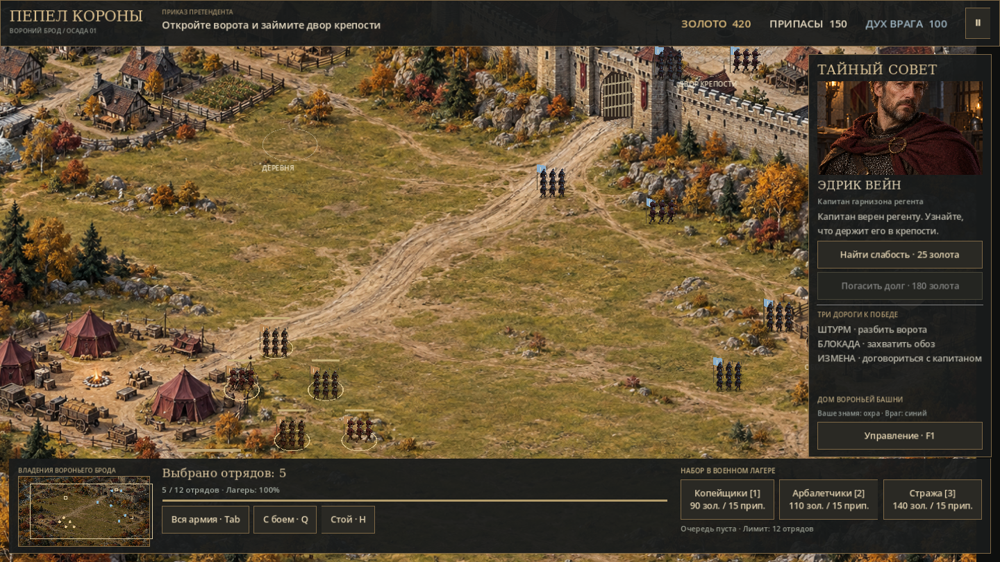

# Пепел короны

Нативная RTS для Windows на **Godot 4.5.2**. Первая миссия: осада Вороньего брода. Управление отрядами, измена гарнизона и три пути к победе.



## Скачать игру

Готовые Windows-сборки: [Releases](https://github.com/dekavova-a/-/releases). Скачайте `AshesOfTheCrown-Windows.zip`, распакуйте архив и запустите **AshesOfTheCrown.exe**. Godot устанавливать не требуется.

После каждого изменения [GitHub Actions](https://github.com/dekavova-a/-/actions/workflows/godot.yml) проверяет проект движком, запускает тесты, снимает настоящий скриншот и собирает Windows x64. ZIP также доступен в артефакте `AshesOfTheCrown-Windows` успешного запуска.

**Code → Download ZIP скачивает исходники, а не готовую игру.** Для разработки откройте `godot/project.godot` в Godot 4.5.2.

## Миссия

Заведите свой исходный или нанятый отряд во двор крепости и удержите его 10 секунд без врагов рядом. Поддержавший вас гарнизон сам по себе не завершает осаду.

- **Штурм:** атакуйте решётку (1200 HP), чтобы открыть проход.
- **Блокада:** захватите обоз на востоке и дождитесь падения боевого духа гарнизона.
- **Измена:** расследование в Тайном совете стоит 25 золота и занимает 8 секунд. Погашение долга гарнизона стоит 180 золота, переговоры занимают 6 секунд. Капитан открывает ворота и передаёт вам два отряда.

Деревня даёт дополнительные золото и припасы. Обоз приносит разовый запас. Найм занимает 7 секунд и расходует оба ресурса. Лимит: 12 дружественных отрядов, включая перебежчиков. Вылазки регента начинаются со 100-й секунды. Потеря лагеря означает поражение.

## Управление

| Действие | Кнопка |
| --- | --- |
| Выделить отряд / группу | ЛКМ / рамка |
| Добавить к выделению | Shift |
| Движение / атака | ПКМ по земле / врагу / воротам |
| Движение с боем | Q, затем ЛКМ |
| Стоп / вся армия | H / Tab |
| Найм копейщиков / арбалетчиков / стражи | 1 / 2 / 3 |
| Камера | WASD / стрелки / средняя кнопка |
| Камера к выделению / масштаб | F / колесо |
| Миникарта | ЛКМ для перемещения камеры |
| Пауза / справка / полный экран | Esc или Пробел / F1 / F11 |

## Исходники

- `godot/project.godot`: открыть в редакторе.
- `godot/scenes/`: игровая сцена.
- `godot/scripts/`: миссия, A*, отряды, ворота, HUD.
- `godot/assets/`: сгенерированная карта, портрет и прозрачные анимационные атласы.
- `godot/tests/`: проверки движком.
- `docs/`: управление, арт-пайплайн и лицензии.
- `legacy/iron-march/`: сохранён предыдущий браузерный прототип.

Графика: фиксированная 2.5D-камера, карта 1536×1024, два атласа с 8 направлениями и 4 фазами движения, портрет капитана. Отряды состоят из отдельных спрайтов; число видимых бойцов уменьшается вместе с HP. Стража пока использует атлас копейщика с другим оформлением.

Это первый игровой срез. Пока нет кампании, сохранений, дипломатии нескольких домов, мультиплеера и звукового оформления. Атаки и гибель используют предварительные эффекты и позы. Здания представлены фоновым артом с отдельно заданными проходами; свободного строительства и разрушения стен пока нет.

## Проверка и сборка

```bash
godot --headless --path godot --editor --import --quit
godot --headless --path godot --script res://tests/test_mission.gd
mkdir -p build/windows
godot --headless --path godot --export-release "Windows Desktop" ../build/windows/AshesOfTheCrown.exe
```

Нужны официальный редактор 4.5.2 и export templates той же версии. Внешних плагинов и пакетов нет. Рендер Compatibility / OpenGL. Логика проверяется в headless, скриншотам нужен графический контекст.

Ассеты и промпты: [ART_PIPELINE.md](docs/ART_PIPELINE.md). Лицензия движка: [GODOT_LICENSE.txt](docs/GODOT_LICENSE.txt). Лицензия шрифта: `godot/assets/fonts/LICENSE.txt`.
